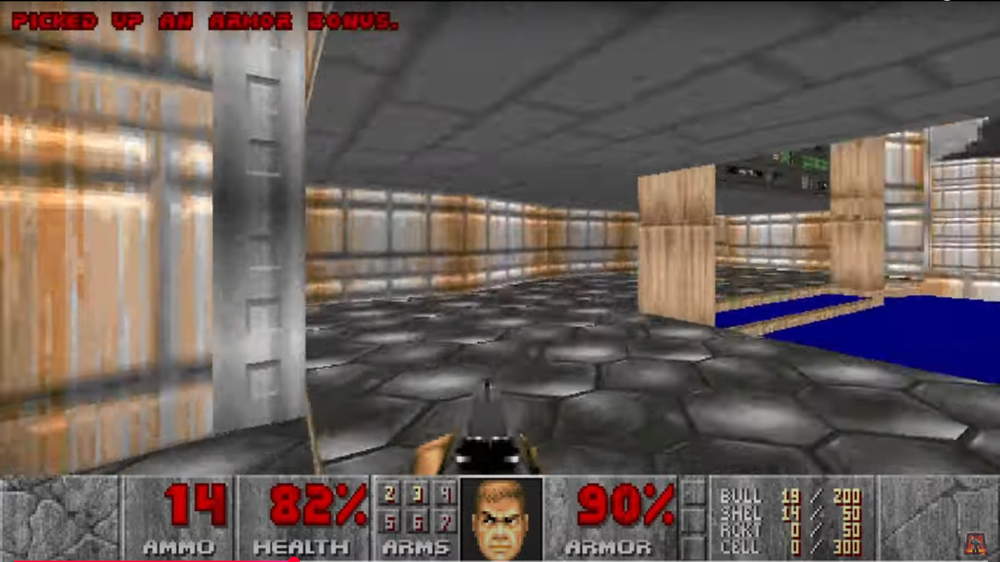

<!-- GENERAL GAME INFO -->
 

  <h2 align="center">DOOM</h2>

  

    The Doom video games consist of first-person
    shooters in which the player controls an unnamed
    space marine commonly referred to as Doomguy.
    In the future, an unnamed marine fights for survival
    on a space station on Mars where
    the Union Aerospace Corporation accidentally opened up
    a physical portal to Hell.
     
    (this project was aproved by jeff)
     
    <strong>Original game : </strong>
    <a href="https://www.imdb.com/title/tt0286598/plotsummary/"><strong>General info »</strong></a>
    ·
    <a href="https://www.youtube.com/watch?v=FTnMy1X_Hes"><strong>Youtube video »<strong></a>
     
     
  

<!-- TABLE OF CONTENTS -->

  
Table of Contents

  <ol>
    <li>
      <a href="#about-the-project">About The Project</a>
    </li>
    <li>
      <a href="#my-version">My version</a>
    </li>
    <li>
      <a href="#getting-started">Getting Started</a>
    </li>
    <li><a href="#how-to-play">How To Play</a></li>
    <li><a href="#class-structure">Class structure</a></li>
    <li><a href="#checklist">Checklist</a></li>
    <li><a href="#contact">Contact</a></li>
    <li><a href="#acknowledgments">Acknowledgments</a></li>
  </ol>

<!-- ABOUT THE PROJECT -->
## About The Project

Here's why:
* It was a pivotal game in the games industry
* It would be an interesting challenge
* I wanted to make it for programing for artists when i did GGP but wasn't allowed. No way am i not making it now that i'm doing GD

(<a href="#readme-top">back to top</a>)

## My version

This section gives a clear and detailed overview of which parts of the original game I planned to make.

### The minimum I will most certainly develop:
* [x] the level generation (geometry) and it's collision
* [x] the basis of the UI (showing health, armor amo)
* [x] the enemies and items
* [x] being able to kill the nemies

### What I will probably make as well:
* [x] the apropriate texture assignemnt to the level geometry
* [x] switching weapons and their properties (and it's ui visualization)
* [x] the apropriate sounds and visual cues for enemies and items
* [x] showing the level stats in the ui

### What I plan to create if I have enough time left:
* [ ] start screen and end screen
* [ ] animated environment textures in the apropriate locations
* [x] the doom guy head in the ui
* [ ] imp enemy specific behaviour

(<a href="#readme-top">back to top</a>)

<!-- GETTING STARTED -->
## Getting Started
Detailed instructions on how to run your game project are in this section.

### Prerequisites

This is an example of how to list things you need to use the software and how to install them.
* Visual Studio 2022

### How to run the project

Explain which project (version) must be run.
* any extra steps if required 

(<a href="#readme-top">back to top</a>)

<!-- HOW TO PLAY -->
## How to play
You shoot the enemies, if they're trying to shoot you, you can avoid being hit by quickly finding cover.
shotgun shoots multuple pellets per bullet.

Kill the enemies and find the end of the base. Good luck marine.

### Controls
* wasd for moving up, left, down, right
* space to jump ( not in original game, but i suck and need a way to skip most of the level to make it to the end )
* left mouse button to shoot
* 1 and 2 to switch weapons (2 becomes available once the second weapon type was picked up)
* mouse movement to rotate camera

(<a href="#readme-top">back to top</a>)

<!-- CLASS STRUCTURE -->
## Class structure 

### Object composition 
If you applied object composition (optional); explain where and how.

we have classes like:
* navigator
* interactor
* weaponmanger
* healthmanager

that exist to grant other object certain abilities
respectively:
* "ai" navigation, like a brain for npc's : Enemies 
* afecting the player under circomstances ( curent implementation if close-> add something to player ) : pickups
* owning and handeling different weapons and their amunition : player 
* having health : shootables ( not realy implemented atm), enemies, player )

### Inheritance 
Explain where you applied inheritance (mandatory).

thing -> shootable -> enemy  
thing -> powerUp
* thing : things that can exist in the level  
* shootable : things that can be afected by amo  
* enemy : shootable that can walk around and shoot the player  
* powerUp : thing that can be picked up and which will affect the player

    
interactor -> healthInteractor  
interactor -> weaponInteractor  
* interactor : ability to interact with a component of the player  
* healthInteractor : interactor that affects the healthmanger  
* weaponInteractor : interactor that affects the weaponmanager  

weapon -> pistol  
weapon -> shotgun

### ..

(<a href="#readme-top">back to top</a>)

<!-- CHECKLIST -->
## Checklist

- [x] Accept / set up github project
- [X] week 01 topics applied
    - [X] vectors
    - [X] transformations
- [X] week 02 topics applied
    - [X] const keyword applied proactively (variables, functions,..)
    - [X] static keyword applied proactively (class variables, static functions,..)
    - [X] object composition (optional)
- [x] week 03 topics applied
    - [x] class relationships (aggregation, association, inheretance) 
        - [x] aggregation (window is aggragated to ui and camera, ...)
        - [ ] association (not realy, any instance where it's sort of the case they know about the subsystem of the other, like healthmanager)
        - [x] inheretance ( see inheretance )
- [x] week 04 topics applied
    - [x] polymorphism ( things array )
- [x] week 05 topics applied
    - [x] operator overloading (does rule of 5 assignment operator count?)
- [x] week 06 topics applied
    - [x] copy semantics (rule of 55555)
- [x] week 07 topics applied
    - [ ] object slicing (no could MAYBE have donw it with dying enemies but like why would i want unused data? what if i wanna revive that **)
    - [x] value cathegories (rule of 55555)
- [x] week 08 topics applied
    - [x] move semantics (rule of 55555)
- [x] week 09 topics applied (optional)
    - [x] streams. (yes. data reading. ha. haha. so funny. not realy? idk i did most of the data reading before we saw this.)
- [x] week 10 topics applied (optional)
    - [x] error handeling ( didn't need it at this point, but made the apropriate functions noexept )

(<a href="#readme-top">back to top</a>)

<!-- CONTACT -->
## Contact

Ferentz Indeherberge - Ferentz.indeherberge@student.howest.be

Project Link: [https://github.com/HowestDAE/dae15-Ferentz_Indeherberge](https://github.com/HowestDAE/dae15-Ferentz_Indeherberge)

(<a href="#readme-top">back to top</a>)

<!-- ACKNOWLEDGMENTS -->
## Acknowledgments

Use this space to list resources you find helpful and would like to give credit to. 

* [Example 1: cpp reference on std::vector](https://en.cppreference.com/w/cpp/container/vector)
* [doom documentation 1](https://doom.fandom.com/wiki/Doom_Wiki)
* [doom documentation 2](https://zdoom.org/wiki/Main_Page)
* [chatgp cuz I dont always have a teacher around to tell me i made a dumb typo and that's why my shit doesnt work](https://chatgpt.com/g/g-cksUvVWar-code-gpt)

(<a href="#readme-top">back to top</a>)

